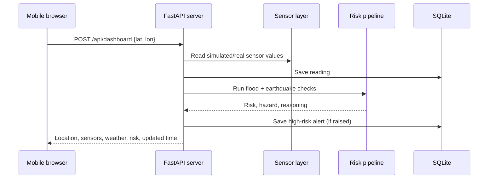
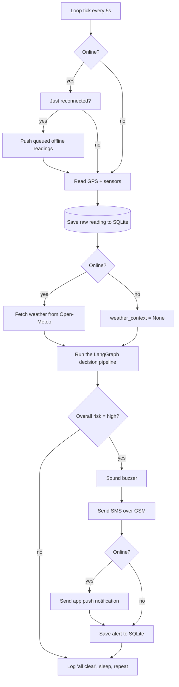
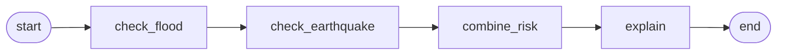

# Walking through the Disaster Alert project

I went through every file in this repo — not just skimmed, actually read the logic — so here's the full picture: what it does, why it's put together the way it is, where it's strong, and where it'll bite you later. Written the way I'd explain it to a teammate over a call, not as a spec sheet.

---

## The one-line version

It's a small box (or a laptop pretending to be one) that watches a water sensor, a rain gauge, a pressure sensor and a vibration sensor, decides every 5 seconds whether a flood or an earthquake is likely, and if so — sets off a buzzer and fires an SMS. Internet is treated as a bonus, never a dependency. If Wi-Fi dies, the alerting doesn't even blink.

That "offline is the default, online is a bonus" idea is the single decision that shapes almost every other file in this project, so it's worth holding onto before looking at the code.

---

## Recent mobile UI integration (19 September 2026)

The supplied **Disaster Connect** mobile interface is now the frontend served at `http://localhost:5000`. This was an integration change, not a rewrite of the detection system: the flood/earthquake agents, SQLite schema, alert dispatcher, thresholds, and hardware simulation are unchanged.

### Files changed or added

| File | Change |
|---|---|
| `frontend/index.html` | Replaced the previous desktop dashboard markup with the supplied mobile-first Disaster Connect interface. |
| `frontend/mobile.css` | Added the supplied responsive mobile styling. |
| `frontend/mobile.js` | Added Home, Shelter, SOS, AI Prediction, Report, cached last location/shelters, browser notifications, call links, share-location support, and quiet offline fallback. |
| `backend/server.py` | Added `POST /api/dashboard` for live mobile checks and `GET /api/prediction` for local sensor-trend data. |
| `network/weather.py` | Extended Open-Meteo data with temperature, rain, precipitation, readable weather condition, and icon name; its flood-risk data and fail-safe behavior remain intact. |
| `README.md` | Updated the web UI documentation for the mobile Home, Shelter, SOS, and Report screens. |

### New mobile API flow



`/api/dashboard` uses the same `read_sensors()`, `run_agent()`, and `dispatch_alert()` path as the existing live endpoint. A high-risk reading therefore still triggers the normal buzzer/SMS/push behavior and is written to the existing alert history.

The Home screen gets GPS from the browser, but only posts latitude and longitude to this local server. GPS does not require internet access: when the server reports offline mode, the browser still attempts GPS and runs the same local sensor pipeline. If the browser itself cannot supply GPS, the app quietly uses its last saved location rather than showing an extra offline-location workflow. For quick testing on a device where plain HTTP GPS is blocked, `?lat=18.5204&lon=73.8567` on the URL also works.

The **AI Prediction** tab is a transparent, short-term trend estimate over recent SQLite readings. It charts water level and vibration, projects a few readings forward, and explains which values were compared to the configured flood threshold. It does **not** claim to predict earthquakes: the seismic chart is activity monitoring only, because a short local vibration history cannot reliably predict an earthquake. When online and configured with `GROQ_API_KEY`, Groq rewrites the risk explanation for both low- and high-risk results; it can never change the rule-based risk level or trigger.

### Verification performed

- Python syntax check passed for `backend/server.py` and `network/weather.py`.
- JavaScript syntax check passed for `frontend/mobile.js`.
- The live FastAPI server started successfully on port 5000.
- `POST /api/dashboard` returned `200` with all required mobile fields: `online`, `location`, `sensors`, `weather`, `risk`, and `updated`.
- `GET /api/prediction` returned `200` with the flood/seismic trend estimates, thresholds, explanation, and local samples used for the charts.
- The root page, `mobile.css`, and `mobile.js` were all confirmed to be served successfully by FastAPI.

---

## Why offline-first, specifically

Think about where this thing is actually meant to sit: a riverside village, a shed near a fault line, somewhere that loses power and signal exactly when a flood or quake is happening. A system that needs a cloud API to tell someone "get out" is a system that fails at the one moment it matters most.

So the rule baked into this codebase is: **the alert decision is always rule-based, always local, always instant.** The internet, when it's there, is only allowed to *add* things — a weather cross-check, a push notification, a nicer sentence from an LLM. It's never allowed to be a requirement. You'll see this same pattern repeated in almost every file: try the network, and if it fails for *any* reason, silently fall back to the offline path instead of crashing.

---

## The folder tour

```
main.py            → the loop that ties everything together
config/settings.py → every threshold and switch, in one place
sensors/reader.py  → pretends to be GPS + 4 physical sensors
network/           → "are we online?", weather lookup, earthquake history
agents/            → the actual decision-making (flood check, quake check, LangGraph)
alerts/            → buzzer, SMS, push notification, save-to-db
database/db.py     → SQLite, the system's memory
backend/server.py  → FastAPI endpoints + serves the mobile web page
frontend/          → mobile web UI (index.html, mobile.css, mobile.js) + legacy dashboards
data/              → the SQLite file + a hand-picked earthquake catalog
scripts/           → double-click .bat/.sh launchers
```

Each folder really does just one job, and they only talk to each other through plain dicts — `sensors`, `location`, `weather_context`, and the final `result`. That's a deliberate seam: you can rip out `sensors/reader.py` and plug in real hardware without touching `agents/` at all.

---

## What actually happens on one loop iteration

This is the part worth understanding before anything else, because everything downstream is a variation on it.

1. **Check connectivity.** `network/connectivity.py` opens a raw TCP socket to `8.8.8.8:53` (Google's DNS) instead of fetching a webpage. That's a deliberate speed trick — a socket connect fails or succeeds in well under a second, so it's cheap enough to run on *every single loop*, not just once at startup.
2. **Read GPS + the four sensors.** Right now these are simulated (random numbers with an occasional deliberate "danger spike" so you actually see the system fire). Swapping in real hardware later means filling in the commented-out block in `sensors/reader.py` — nothing else changes.
3. **Save the raw reading to SQLite**, immediately, before any decision is made. This matters: even if the risk logic or the network dies mid-loop, the raw data point is already safely on disk.
4. **If online, ask Open-Meteo for the current rain/pressure at this exact lat/lon.** If that call fails for any reason — timeout, bad response, DNS hiccup — it just returns `None` and the rest of the pipeline treats it as "no extra data," never as an error.
5. **Run the decision graph** (more on this below) — this is where flood risk and earthquake risk actually get computed.
6. **Dispatch an alert if risk is high.** Buzzer and SMS always fire. App push only fires if we're online. Everything gets logged to the `alerts` table regardless.
7. **Sleep 5 seconds, repeat.**

And there's one more behaviour worth calling out: the *moment* the loop notices it's gone from offline back to online, it walks through every reading that got saved during the outage and marks it synced. So a period with no signal doesn't lose data — it just queues it up for later.

---

## The workflow, drawn out



And inside step J, the actual decision graph (this is the LangGraph part — `agents/graph.py`) is a straight line, no branching, no loops:



Two things worth noticing about that graph:

- **It's a chain, not really a "graph."** LangGraph is doing very little work here — there's no branching, no cycles, no tool-calling, no agent re-planning itself. It's used more like a documented, typed pipeline than an actual agentic system. That's not a criticism, just worth knowing going in: you could rewrite this as four plain function calls and lose nothing except the diagram.
- **`explain` is the *only* node that can touch an LLM, and it's opt-in and consequence-free.** It only fires when you're online, `USE_LLM_EXPLANATION=true`, a Groq key is set, *and* risk is already high. All it's allowed to do is rewrite the human-readable sentence — it can never flip a "low" into a "high" or vice versa. If the API call fails, it just keeps the rule-based sentence. That "LLM can decorate, never decide" boundary is the right call for a safety system.

---

## The pieces, one by one, in plain terms

**`config/settings.py`** — every number that might need tuning lives here and nowhere else: how high water has to get before it counts as a flood (80cm from the sensor — note lower number means the water is *closer* to the sensor, i.e. higher), how hard rain has to fall (30mm/hr), the vibration ratio that counts as a quake (3.0), how often the loop runs (5s). If you ever need to tune this system against real local data, this is the only file you touch.

**`sensors/reader.py`** — simulates a water sensor, rain gauge, barometer and accelerometer. About 15% of loops roll a "flood-ish" reading and 10% roll a "quake-ish" vibration spike, purely so you see the system actually alert sometimes instead of sitting idle forever. Every real-hardware wire-up (GPS via NEO-6M, water level via HC-SR04 ultrasonic, pressure via BME280, vibration via MPU6050) is already sketched out in comments — it's a fill-in-the-blanks job, not a redesign.

**`network/connectivity.py`** — answers one question, fast: are we online right now? Uses a raw socket instead of an HTTP request specifically so it stays cheap enough to call every 5 seconds forever.

**`network/weather.py`** — asks Open-Meteo (no API key needed) for current rain and pressure at the given coordinates, purely as a second opinion for the flood check. Fails silently and safely — any network hiccup just means "no extra opinion this time," not a crash.

**`network/earthquakes.py`** — this one's only used by the test simulator, not the live loop. Given a date and a country, it checks USGS's real historical earthquake feed (if online) and a small bundled JSON catalog (`data/earthquake_catalog.json` — currently seeded with things like the 2018 Palu M7.5 and the 2004 Sumatra M9.1), merges and de-duplicates the results, and hands back matching events. It exists so you can demo "pick 28 Sept 2018, Indonesia" and get a real, reproducible high-risk alert instead of waiting for the random simulator to roll a spike.

**`agents/flood_agent.py`** — three independent triggers, any one of which is enough: water sensor reads dangerously high, rain rate crosses the threshold, or (only if online) the external forecast also shows heavy rain. Purely rule-based on purpose — no ML model, no black box, and you can read the exact reason a flood alert fired straight out of the returned string.

**`agents/earthquake_agent.py`** — uses STA/LTA (short-term average vs long-term average), which is the actual real-world technique seismologists use to catch a sudden spike in vibration against a noisy baseline, without needing a trained model. It keeps a rolling window of the last 200 readings and compares the last 5 against that. Also has a side door: if the test simulator hands it a known historical event, it skips the math entirely and reports that instead.

**`agents/graph.py`** — wires the two agents above together with LangGraph, combines their verdicts (earthquake risk wins if both are high — makes sense, an earthquake is usually the more immediately dangerous, faster-onset event), and optionally lets an LLM rephrase the explanation. Covered in more detail above.

**`alerts/dispatcher.py`** — splits notification channels into two tiers on purpose: buzzer + SMS-over-GSM are the "these must work with zero internet" tier, app push is the "nice to have when online" tier. Every alert, whichever channels fired, gets written to the `alerts` table for history. Right now the SMS contact list is a single hardcoded number in the source (`+917620622761`) — fine for a demo, but that's the first thing you'd want to move into config or a proper contacts table before this touches anyone for real.

**`database/db.py`** — plain SQLite, two tables. `readings` keeps every sensor snapshot plus a `synced` flag (this is what makes the "catch up once we're back online" behavior possible). `alerts` keeps every decision the system ever made, with its reasoning, so you can audit *why* an alert fired after the fact.

**`backend/server.py` + `frontend/index.html`** — a FastAPI backend now serves the mobile-first Disaster Connect UI. Its key mobile endpoint is `POST /api/dashboard`: the page posts browser GPS `{lat, lon}`, the server reads sensors, saves the reading, optionally enriches it with weather, runs the same agent pipeline as `main.py`, dispatches any high-risk alert, and returns the mobile-friendly dashboard payload. The supplied UI also uses `/api/safe-houses` for nearby candidate shelters and `/api/alerts` for the Report screen. The frontend has no framework dependency and keeps last known location/shelter results in local storage for graceful offline fallback.

**`frontend/dashboard.py`** — a Streamlit page that just reads straight from the SQLite file and shows recent alerts + a line chart of water level and vibration over time. Doesn't need the Flask server running at all — it's a separate, independent way to look at the same data.

**`frontend/test_simulator.py`** — the most fun file to read. Pick a date range and a country from a dropdown, hit "Detect," and it calls the *exact same* `run_once()` function `main.py` uses (imported directly, not reimplemented), overriding only the GPS location and feeding in the historical earthquake lookup. Draws the result on a world map with pydeck, plus a magnitude-over-time bar chart. This is genuinely a nice touch — it's testing the real pipeline, not a mocked-up demo version of it.

---

## Four different ways to run the same brain

| You run… | What you get |
|---|---|
| `python main.py` | The actual always-on monitoring loop |
| `python -m backend.server` | A local web page at `localhost:5000` you can open on your phone |
| `streamlit run frontend/dashboard.py` | Charts + alert history, read straight from SQLite |
| `streamlit run frontend/test_simulator.py` | Pick a real historical disaster and watch the pipeline react to it |

All four eventually call into the same `agents/graph.py` — there's exactly one decision-maker in this whole project, just several different doors into it. That's a good sign; it means there's no risk of the web version and the CLI version quietly disagreeing with each other.

---

## What's genuinely good here

- **The offline-first boundary is real, not just a README claim.** I checked — every single network call in the codebase (weather, USGS, LLM) is wrapped so a failure degrades gracefully instead of raising. That discipline is consistent across the whole repo, not just in one or two spots.
- **The decision logic stays rule-based and auditable.** No black-box model deciding whether to wake someone up at 3am — every alert comes with a plain-English reason you can trace back to a specific number crossing a specific threshold.
- **Clean separation of concerns.** Swapping simulated sensors for real GPIO hardware, or adding a third hazard type (wildfire, landslide — the README even sketches out exactly how), doesn't require touching the alerting or database code at all.
- **The LLM is on a short leash.** It can only narrate a decision that's already been made, never make one. That's exactly the right amount of trust to give it in a system where a false negative could hurt someone.
- **The test simulator actually exercises production code**, not a separate mocked path. That's the difference between a demo and a test.
- **There's CI** (`.github/workflows/ci.yml`) that boots the loop once, starts the Flask server and hits every endpoint, and import-checks every module — lightweight, but it'd catch a broken import or a crashed startup before it reaches anyone.

---

## Where it's rough, or will need attention before it's real

- **Everything physical is currently fake.** GPS, water level, rain, pressure, vibration — all `random.uniform()` calls dressed up to look plausible. That's completely fine for building and demoing the *logic*, but none of the thresholds in `config/settings.py` have been validated against a real sensor's actual noise floor yet. Expect to retune all three numbers once real hardware is attached.
- **Single hardcoded phone number.** `alerts/dispatcher.py` defaults to one contact baked into the source. Works for a one-unit demo, falls apart the moment you need per-region contact lists or more than one recipient.
- **The vibration history is a single global in-memory deque.** `_vibration_history` in `earthquake_agent.py` lives at module level, which is fine for one field unit running one process — but it resets to empty every time the process restarts, and it can't be meaningfully shared if you ever run multiple instances or restart the service often (e.g. a crash-loop would keep re-priming an empty LTA window instead of alerting).
- **No authentication anywhere.** The FastAPI API and the web page have zero access control. Acceptable when it's strictly `localhost`-only on a device you physically control; becomes a real problem the moment `server.py` gets exposed on a real network (`host="0.0.0.0"` already listens on all interfaces).
- **`GROQ_API_KEY` read straight from an environment variable with no `.env` handling shown**, and no validation that it's actually a usable key before the first real call — it'll just silently fall back on failure, which is safe but can also hide a misconfiguration for a while.
- **LangGraph is arguably more machinery than this pipeline needs.** It's a straight line with no branching or cycles — four plain function calls chained together would do the identical job with one fewer dependency and no framework to learn. Worth keeping only if you're planning to actually branch or add cycles later (e.g. a node that re-checks a sensor before committing to "high").
- **A few loose ends I noticed while reading:**
  - `test.py` at the repo root is just the word `import` — dead file, not wired into anything.
  - `requirements.txt` has `groq` and `google-generativeai` indented with a leading space under a comment, and `google-generativeai` isn't actually imported anywhere in the code (only `groq` is used, and only lazily inside `graph.py`).
  - The offline earthquake catalog is small and hand-picked — great for demos, but it's not a substitute for a real historical dataset if this ever needs to answer "did an earthquake happen here" for an arbitrary country/date combo.

None of these are "the project is broken" — they're exactly the kind of thing you'd expect in a system that's deliberately been built simulation-first, with real hardware and real deployment concerns deferred on purpose. They're just the honest list of what's between here and a device sitting in a real village.

---

## If I were picking up this repo next

1. Wire up one real sensor at a time (water level is the easiest, an HC-SR04 is cheap and simple) and watch how far off the simulated thresholds are from reality.
2. Move the SMS contact list out of source code and into `config/settings.py` or a small table, so it's not a code change to add a recipient.
3. Decide if LangGraph earns its keep here — either lean into it (add a real branch, e.g. skip the earthquake check entirely if the accelerometer is known to be offline) or simplify it back to plain function calls.
4. If the Flask server is ever going to run on an actual local network (not just `localhost` on one device), it needs at least a shared secret or token before `/api/location` accepts requests.
5. Delete `test.py`, or turn it into an actual test file — right now it's just noise.
